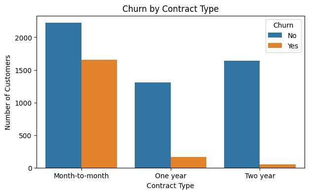
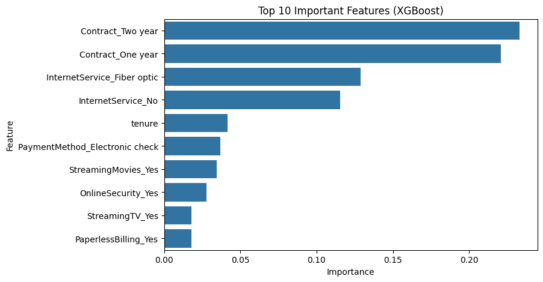
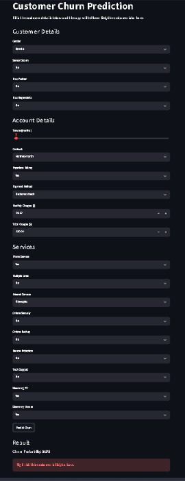

# Customer Churn Prediction

A machine learning project that predicts whether a telecom customer is going to leave the company (churn) or stay. I built a classification model on the Telco Customer Churn dataset and made a small Streamlit app where anyone can enter customer details and see the churn risk.

## Problem Statement

Getting a new customer costs more than keeping an old one. If a company can find out which customers are likely to leave, it can contact them early with an offer. So the goal of this project is to catch as many churning customers as possible.

## Dataset

- Source: Telco Customer Churn dataset from Kaggle

- 7043 customers and 21 columns (contract, tenure, internet service, monthly charges and so on)

- Target column: Churn (Yes or No)

- Around 27% of customers churned, so the data is imbalanced

## What I Did

1. Data cleaning: fixed TotalCharges (it was stored as text), removed 11 rows with missing values and dropped customerID

2. EDA: checked how contract type, tenure, monthly charges and internet service affect churn

3. Data preparation: one-hot encoding, train-test split (80/20, stratified) and scaling of numeric columns

4. Model building: trained Logistic Regression, Random Forest and XGBoost, and used class weights to handle the imbalance

5. Model comparison using precision, recall, F1-score and ROC-AUC

6. Saved the final model with joblib and built a Streamlit app

## Key Findings

- Month-to-month customers churn the most, one and two year contracts keep customers much longer

- Most churn happens in the first year or two

- Customers with a higher monthly bill churn more

- Fiber optic customers churn more than DSL customers

## Model Results

| Model | Churn Recall | Churn Precision | ROC-AUC |

|---|---|---|---|

| Logistic Regression | 0.57 | 0.65 | 0.836 |

| Logistic Regression (balanced) | 0.79 | 0.49 | 0.835 |

| Random Forest (balanced) | 0.67 | 0.55 | 0.820 |

| XGBoost | 0.80 | 0.50 | 0.840 |

I chose XGBoost as the final model because it had the best ROC-AUC and the best recall for churn customers. It catches about 80% of the customers who are going to leave. The trade-off is lower precision, which I think is fine here because missing a customer who is leaving costs more than giving an offer to someone who would have stayed anyway.

## Streamlit App

The app takes 19 customer details and shows the churn probability with a high risk or low risk message.

## Project Structures

churn-prediction-project/

|-- app/ Streamlit app (app.py)

|-- data/ dataset (telco_churn.csv)

|-- images/ charts and app screenshot

|-- models/ saved model, scaler and columns

|-- notebooks/ Jupyter notebook (churn_prediction.ipynb)

|-- requirements.txt

|-- README.md

## How to Run

1. Clone this repository and open the folder in a terminal

2. Install the libraries: `pip install -r requirements.txt`

3. Start the app: `streamlit run app/app.py`

## Tools Used

Python, pandas, numpy, matplotlib, seaborn, scikit-learn, XGBoost, joblib, Streamlit

## Future Improvements

- Tune the model parameters

- Add SHAP to explain individual predictions

- Deploy the app online

